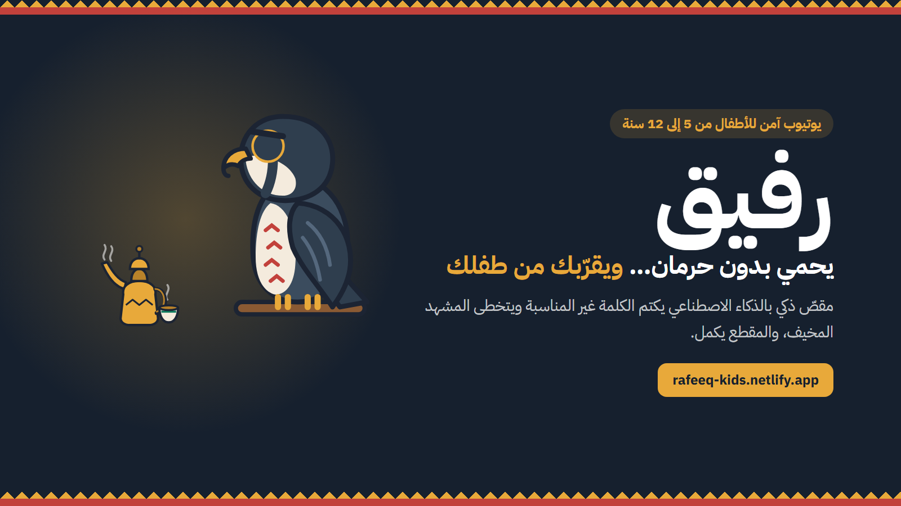
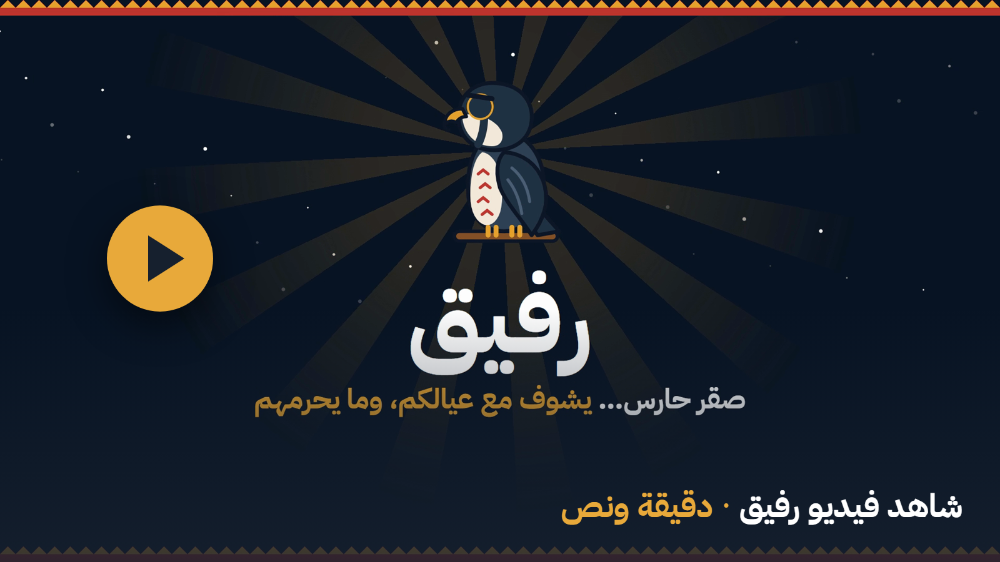
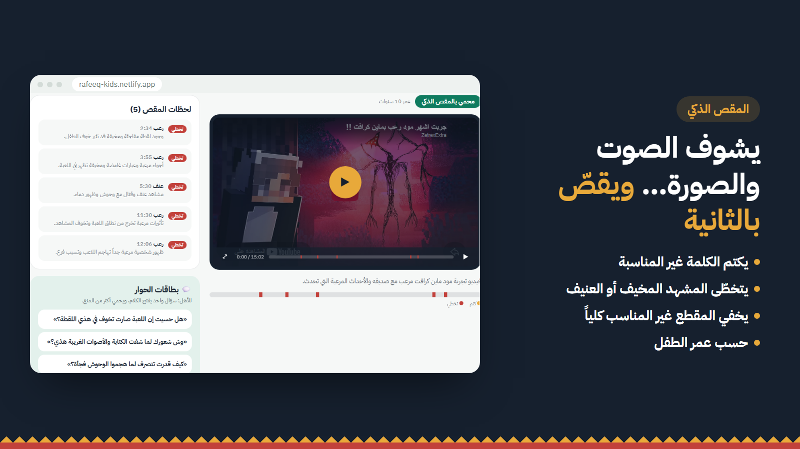
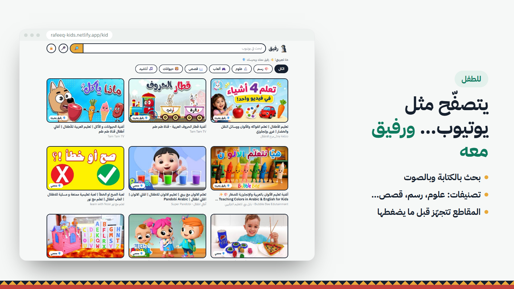
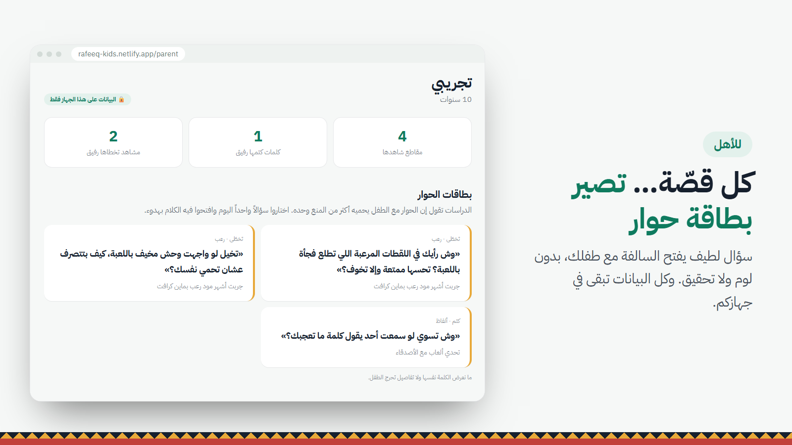

# رفيق 🦅

**يوتيوب آمن للأطفال (5–12 سنة)… يحمي بدون ما يحرم.**

رفيق يشاهد المقطع مع طفلك بالذكاء الاصطناعي، ويقصّ **اللحظة** غير المناسبة فقط، لا المقطع كامل؛ ويحوّل كل قصّة إلى **حوار** يقرّب الأهل من أطفالهم.

🌐 **جرّبه الحين:** [rafeeq-kids.netlify.app](https://rafeeq-kids.netlify.app)

---

## 🎬 فيديو تعريفي

---

## 🤔 المشكلة

الطفل يشاهد مقطعاً يحبّه… وفجأة تظهر لقطة مخيفة أو كلمة ما تناسب عمره.

وأدوات الرقابة اليوم تضع الأهل بين خيارين، وكلاهما مكلف:

| الحجب الكامل | الترك الكامل |
|---|---|
| يُحرم الطفل من محتوى مفيد، فيبحث عنه بطريقة ثانية | يتعرّض لما لا يناسب عمره، والأهل ما يدرون |

والدراسات تؤكد أن **أدوات الرقابة وحدها ما تكفي**: الحماية الحقيقية تبدأ لما تجتمع **الأداة** مع **الحوار الأسري**.

---

## 💡 الحل: كيف يشتغل رفيق؟

1. **الأهل يجهّزونه مرة وحدة:** اسم الطفل، وعمره، ورمز سري.
2. **الطفل يتصفّح مثل يوتيوب:** يبحث بالكتابة أو بصوته، ويختار ما يحب.
3. **رفيق يشاهد المقطع قبله:** بالصوت والصورة، ويحدد اللحظات غير المناسبة بالثانية وحسب العمر.
4. **المقص الذكي يشتغل أثناء المشاهدة:** يكتم الكلمة، ويتخطى المشهد، والمقطع يكمّل عادي.
5. **الأهل توصلهم بطاقة حوار:** سؤال خفيف يفتح السالفة مع الطفل، بدون لوم ولا تحقيق.

---

## ✂️ المقص الذكي

- 🔇 **يكتم** الكلمة غير المناسبة.
- ⏭️ **يتخطّى** المشهد المخيف أو العنيف.
- 🛡️ **يخفي** المقطع غير المناسب كلياً من النتائج.
- 🎯 **حسب العمر:** أشد للأعمار من 5 إلى 8، وأخف من 9 إلى 12.
- 🗣️ **يفهم** العربية الفصحى ولهجاتها المحلية، والإنجليزية.

---

## 👧 واجهة الطفل

تشبه يوتيوب في سهولتها: بحث بالكتابة والصوت، وتصنيفات جاهزة، والمقاطع تتجهّز قبل ما يضغطها. والطفل ما يقدر يطلع لموقع يوتيوب من داخل رفيق.

---

## 👨‍👩‍👧 وضع الأهل وبطاقات الحوار

لوحة محمية برمز سري: وش شاف الطفل، وكم مرة قصّ رفيق، و**بطاقة حوار** لكل موقف، بدون عرض الكلمة نفسها أو أي تفاصيل تحرج الطفل.

---

## 🔒 الخصوصية أولاً

- **بدون حسابات** ولا تسجيل دخول.
- **بدون قاعدة بيانات:** ما نجمع أي بيانات عن الأطفال.
- **كل شي على جهاز العائلة:** الاسم والعمر وسجل المشاهدة.
- **رمز سري مشفّر:** الطفل ما يقدر يغيّر الإعدادات.

---

## 🛠️ التقنيات

Next.js · React · TypeScript · Tailwind CSS · Gemini API · YouTube Data API

> الكود المصدري خاص.

